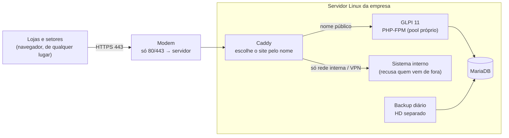

# Central de Chamados de TI

**Portal de chamados de TI para uma rede de 12 unidades** (lojas físicas, e-commerce e depósito central) da **Dorémi Brinquedos**. Os pedidos que chegavam soltos por WhatsApp, telefone e no corredor passam a ser **chamados numerados**, com loja, categoria, prioridade e prazo; as lojas abrem e acompanham pelo navegador, o TI atende por uma fila organizada e a diretoria recebe relatórios de prazos e satisfação.

Baseado no **GLPI 11**, instalado e configurado num servidor Linux da própria empresa, ao lado de outro sistema interno, com isolamento entre os dois.

**Autor:** Jonathan Alves Ribeiro, Técnico de TI na Dorémi Brinquedos · [LinkedIn](https://www.linkedin.com/in/jonathan-alves-ribeiro-95596a303) · outro projeto: [SmartStock AI](https://github.com/jonathanmaldur-ai/smartstock-ai)

     

---

## O problema

- Pedidos de TI chegavam por vários canais, **sem registro**: o que não era anotado se perdia.
- Não havia **prioridade nem prazo**: um caixa parado e um pedido de instalação disputavam a mesma atenção.
- Não havia como mostrar à diretoria **quanto se atende, em quanto tempo e com que qualidade**, nem enxergar problemas que se repetem na mesma loja.

## A solução

| Área | Como funciona |
|---|---|
| **Portal das lojas** | Cada loja entra com o próprio login (e-mail da gerência) pelo PC ou celular, abre o chamado com categoria, descrição e foto, e informa **quem está abrindo** (os colaboradores não têm e-mail próprio). Setores como Diretoria e Administrativo têm login individual. |
| **Categorias** | 10 categorias (Caixa/PDV, ERP, internet, computador, impressora, e-mail e acessos, câmeras, sistema interno, pedidos e outros), cada uma com prioridade padrão. A pergunta "isso está impedindo de vender ou de trabalhar?" eleva o chamado a **Crítico**. |
| **SLA** | Prazos de 1ª resposta e de solução por prioridade (de 15 min / 2 h no Crítico a 4 h / 3 dias úteis no Baixo), contados **só no horário de atendimento** (seg a sex, 08h às 18h). Chamado aguardando a loja ou um fornecedor **pausa o prazo**; aviso ao TI com 80% do prazo gasto. |
| **Ciclo do chamado** | Novo → Em atendimento → Pendente → Solucionado → Fechado, com e-mail à loja a cada mudança. Ao solucionar, a loja confirma e dá **nota de 1 a 5**; sem resposta em 48 h, fecha sozinho. |
| **Relatórios** | Painel do TI (fila, SLA perto de estourar, pendentes há mais de 24 h) e painel gerencial (abertos × fechados, SLA cumprido, tempo médio, satisfação, ranking por loja e categoria, **reincidência**). Relatório mensal automático por e-mail. |
| **Gestão de acessos** | Usuários criados e desativados pela própria plataforma; a pessoa recebe um e-mail e define a própria senha. |

## Infraestrutura e segurança

- **Um servidor, dois mundos.** O portal divide o servidor e o proxy (Caddy, porta 443) com um sistema interno que nunca pode ficar exposto. Como o proxy escolhe o site pelo nome pedido, abrir a porta 443 bastaria para alguém de fora chegar ao sistema interno digitando o nome dele. Por isso o site interno **recusa qualquer origem fora da rede interna e da VPN** (`remote_ip`), e só o portal de chamados responde para a internet.
- **Ordem segura de implantação.** O isolamento é aplicado e validado **antes** de abrir as portas 80 e 443 no modem; a VPN existente (UDP) continua intocada.
- **HTTPS automático** com Let's Encrypt, HSTS e cabeçalhos de segurança; as lojas não instalam nada.
- **Arquivos fora da área pública** (layout recomendado pelo GLPI): código em `/var/www/glpi` com só `public/` servido, configuração em `/etc/glpi`, anexos em `/var/lib/glpi`, logs em `/var/log/glpi`.
- **PHP-FPM com pool dedicado**, cookies de sessão `HttpOnly`, `Secure` e `SameSite`, `expose_php` desligado.
- **Instalação verificada.** O pacote do GLPI é conferido pelo SHA-256 publicado no GitHub antes de ser instalado; senha do banco aleatória e guardada só na configuração do GLPI; senha do administrador gerada e mostrada uma única vez; usuários de exemplo desativados.
- **Configuração do proxy à prova de erro.** A nova configuração é validada antes de aplicar; se for inválida, a anterior volta sozinha e o sistema interno não é afetado.
- **Backup diário** do banco (`mariadb-dump --single-transaction`) e dos anexos num HD separado, com 30 dias de retenção.
- **LGPD.** Só dados de trabalho: loja, pessoa e descrição do problema. Senhas nunca são escritas no chamado.

## O que tem aqui

| Arquivo | Conteúdo |
|---|---|
| [`01 - Projeto.md`](01%20-%20Projeto.md) | Proposta completa: fluxo, categorias, SLA, ciclo, relatórios, segurança e fases |
| [`DECISOES.md`](DECISOES.md) | Decisões aprovadas, numeradas, com o motivo de cada uma |
| [`scripts/servidor/instalar-glpi.sh`](scripts/servidor/instalar-glpi.sh) | Instalação completa do GLPI num único comando (pacotes, banco, PHP, proxy, firewall, tarefas e backup); se o GLPI já existir, para sem alterar nada |

## Fases

1. **Portal no ar:** instalação, HTTPS, categorias, SLA, horário e logins das lojas.
2. **Uso real:** duas semanas com as lojas abrindo chamados e ajuste de categorias, prazos e textos.
3. **Relatórios:** painel gerencial e relatório mensal automático.

---

## Como foi construído

Levantamento com as lojas, decisões, infraestrutura (servidor, rede, DNS, portas e backup) e configuração: Jonathan Alves Ribeiro. Scripts e documentação desenvolvidos com apoio de IA (Claude Code), sob a direção dele.

Publicado para fins de portfólio, com autorização da Dorémi Brinquedos. Endereços, domínio e dados da empresa foram trocados por exemplos (`example.com`, IPs de documentação). Todos os direitos reservados.
